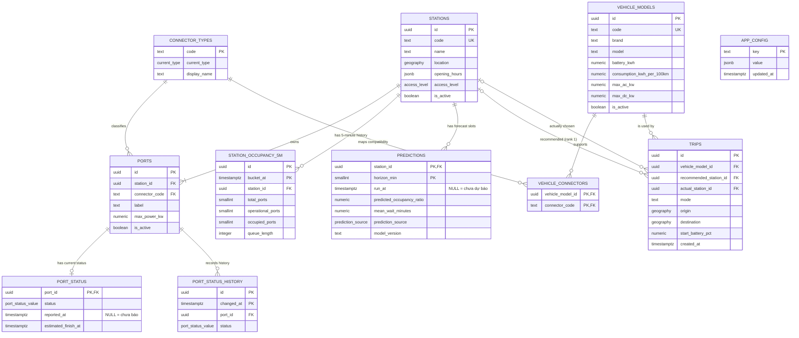

# Database ERD và thống kê dữ liệu

**Database:** `smart_ev_data` — PostgreSQL 16 + PostGIS 3.4
**Phạm vi:** 13 bảng nghiệp vụ của Smart EV; không tính các bảng hệ thống PostGIS/Tiger
và các bảng partition vật lý.
**Nguồn sự thật:** `database/schema/*.sql` (viết tay, không dùng migration), kiểm tra bằng
`database/scripts/verify.py`. Xem [database/README.md](../database/README.md).

Bản demo đơn giản hóa: không còn `station_amenities`, `station_external_refs`,
`station_live_metrics`, `station_arrival_rates`, `planned_arrivals` (arrival rate và planned
arrival đọc từ fixture JSON trong bộ nhớ backend).

## ERD

`port_status_history` và `station_occupancy_5m` được partition theo tháng. Partition tháng được tạo
bằng `ensure_month_partition()` lúc nạp lịch sử và mỗi lần backend ghi occupancy; mỗi bảng có thêm
partition `DEFAULT` làm lưới an toàn.
`station_occupancy_profile` (trạm × thứ × bước 5 phút) là bảng dẫn xuất từ `station_occupancy_5m`.
`app_config` là bảng cấu hình độc lập nên không có khóa ngoại. Hai view:
`station_capacity` và `station_status_current` (backend đọc khi khởi động). `station_status_current`
lấy bucket **mới nhất** của `station_occupancy_5m` cho mỗi trạm (số cổng đang dùng, không cần biết
cổng cụ thể); `port_status` không tham gia.

## Số lượng bản ghi sau bootstrap

| Nhóm | Bảng | Số dòng | Ghi chú |
|---|---|---:|---|
| `catalog` | `stations` | 11 | 11 trạm VinFast |
| `catalog` | `connector_types` | 2 | CCS2, TYPE2 |
| `catalog` | `ports` | 200 | 178 CCS2 (20–250 kW), 22 TYPE2 (3,5–11 kW) |
| `vehicles` | `vehicle_models` | 18 | 18 mẫu xe VinFast |
| `vehicles` | `vehicle_connectors` | 35 | |
| `runtime` | `port_status` | 200 | tuỳ chọn; mỗi cổng một dòng, `status='unknown'`, `reported_at` NULL |
| `history` | `port_status_history` | 0 | backend ghi dần (chỉ khi có báo từng cổng) |
| `history` | `station_occupancy_5m` | 0 | không seed; nạp nguyên CSV tháng 9–10/2026 lúc khởi tạo Docker (có thể ghi thêm qua `POST /api/v1/internal/station-occupancy`) |
| `history` | `station_occupancy_profile` | 0 | dẫn xuất từ `station_occupancy_5m` bằng `refresh_station_occupancy_profile()` |
| `forecast` | `predictions` | 66 | 11 trạm × 6 mốc; chỉ có khóa, mọi giá trị NULL |
| `trips` | `trips` | 0 | do backend ghi (nhật ký bấm Chỉ đường) |
| `config` | `app_config` | 1 | `planned_arrival_window_min = 15` |

## Phân bố chính

| Access | Số trạm |
|---|---:|
| Public | 11 |

Phạm vi địa lý của 11 trạm: longitude `106.65922–106.72233`, latitude `10.70113–10.81201`.

## Điểm cần lưu ý

1. **Trạng thái trạm = bucket occupancy mới nhất.** `station_status_current` tính
   `available = operational − occupied`, `offline = total − operational`. Trạm chưa có bucket nào
   báo `operational_ports = 0`, `unknown_ports = total_ports` cho tới khi nhận số cổng đang dùng qua
   `POST /api/v1/internal/station-occupancy` (khởi động Docker đã nạp sẵn CSV tháng 9–10/2026).
2. **Hàng đợi chỉ có nếu bucket có.** `queue_length` lấy từ `station_occupancy_5m.queue_length`
   (nullable, hiện NULL), nên ước lượng chờ trả `WAIT_INPUT_UNAVAILABLE` cho tới khi có nguồn
   queue/session.
3. **`predictions` là bảng slot.** Backend UPDATE tại chỗ; không lưu lịch sử các lượt chạy.
   Enum `prediction_source` chỉ gồm `persistence` và `model` (API trả thêm `default`).
4. **`trips` là nhật ký bấm Chỉ đường, không phải hành trình.** Mỗi lần người dùng bấm "Chỉ đường"
   (chuyển sang Google Maps) backend ghi một dòng: điểm bắt đầu, điểm kết thúc (NULL khi tìm trạm),
   pin còn, trạm hệ thống đề xuất hạng 1 và trạm thực sự chọn. Arrival/planned arrival nằm trong bộ nhớ.
