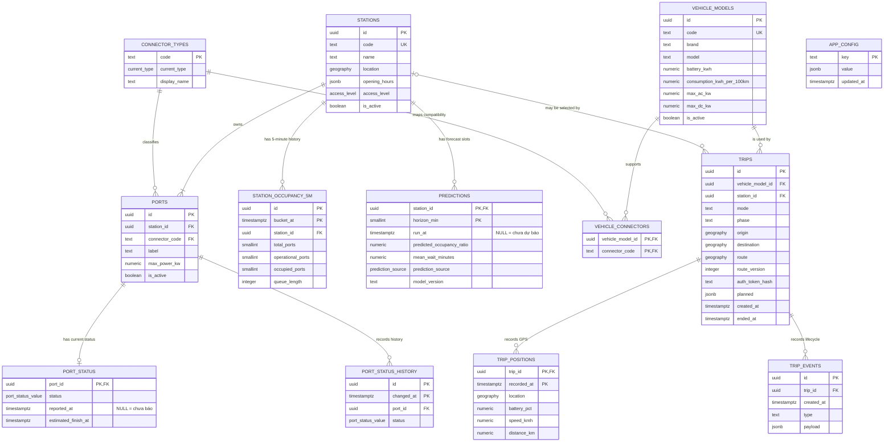

# Database ERD và thống kê dữ liệu

**Database:** `smart_ev_data` — PostgreSQL 16 + PostGIS 3.4
**Phạm vi:** 13 bảng nghiệp vụ của Smart EV; không tính các bảng hệ thống PostGIS/Tiger
và các bảng partition vật lý.
**Nguồn sự thật:** `database/schema/*.sql` (viết tay, không dùng migration), kiểm tra bằng
`database/scripts/verify.py`. Xem [database/README.md](../database/README.md).

Bản demo đơn giản hóa: không còn `station_amenities`, `station_external_refs`,
`station_live_metrics`, `station_arrival_rates`, `planned_arrivals` (arrival rate và planned
arrival đọc từ fixture JSON trong bộ nhớ backend).

## ERD

`port_status_history` và `station_occupancy_5m` được partition theo tháng (09, 10 và 11/2026).
`app_config` là bảng cấu hình độc lập nên không có khóa ngoại. Hai view:
`station_capacity` và `station_status_current` (backend đọc khi khởi động).

## Số lượng bản ghi sau bootstrap

| Nhóm | Bảng | Số dòng | Ghi chú |
|---|---|---:|---|
| `catalog` | `stations` | 11 | 11 trạm VinFast |
| `catalog` | `connector_types` | 2 | CCS2, TYPE2 |
| `catalog` | `ports` | 200 | 178 CCS2 (20–250 kW), 22 TYPE2 (3,5–11 kW) |
| `vehicles` | `vehicle_models` | 18 | 18 mẫu xe VinFast |
| `vehicles` | `vehicle_connectors` | 35 | |
| `runtime` | `port_status` | 200 | mỗi cổng một dòng, `status='unknown'`, `reported_at` NULL |
| `history` | `port_status_history` | 0 | backend ghi dần |
| `history` | `station_occupancy_5m` | 0 | không seed |
| `forecast` | `predictions` | 66 | 11 trạm × 6 mốc; chỉ có khóa, mọi giá trị NULL |
| `trips` | `trips`, `trip_positions`, `trip_events` | 0 | do backend tạo |
| `config` | `app_config` | 1 | `planned_arrival_window_min = 15` |

## Phân bố chính

| Access | Số trạm |
|---|---:|
| Public | 11 |

Phạm vi địa lý của 11 trạm: longitude `106.65922–106.72233`, latitude `10.70113–10.81201`.

## Điểm cần lưu ý

1. **Trạng thái chưa có.** Mọi cổng ở `unknown`, nên `station_status_current` báo
   `operational_ports = 0` và backend coi mọi trạm là offline cho tới khi nhận trạng thái qua
   `POST /api/v1/internal/port-status`.
2. **Không có nguồn hàng đợi.** `queue_length` của view luôn NULL và không còn bảng metrics, nên
   ước lượng chờ trả `WAIT_INPUT_UNAVAILABLE` cho tới khi backend có nguồn queue/session.
3. **`predictions` là bảng slot.** Backend UPDATE tại chỗ; không lưu lịch sử các lượt chạy.
   Enum `prediction_source` chỉ gồm `persistence` và `model` (API trả thêm `default`).
4. **Arrival/planned arrival nằm trong bộ nhớ.** Trip không còn ghi cam kết mềm vào database;
   việc lưu bền được hoãn lại.
