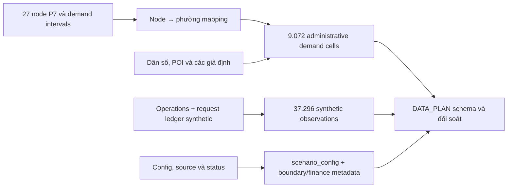

# Bổ sung dữ liệu theo DATA_PLAN

Ngày cập nhật: **13/10/2026**. Snapshot hiện hành: [`demo_hcmc_v3`](../../data_platform/station_planning/demo_hcmc_v3/), ID `hcmc-nine-wards-demo-v3`. Snapshot v1/v2 cùng báo cáo tương ứng được lưu trong Git stash local, không được push. Cơ sở đối chiếu là [DATA_PLAN_VI.md](DATA_PLAN_VI.md); schema kiểm tra dataset version 1.0 nằm tại [planning-datasets.schema.json](schemas/planning-datasets.schema.json).

## Những phần đã bổ sung

| Mô tả trong DATA_PLAN | Output v3 | Cách bổ sung |
|---|---|---|
| `existing_sites.power_kw` | [existing_sites.csv](../../data_platform/station_planning/demo_hcmc_v3/existing_sites.csv) và GeoJSON | Tổng công suất nameplate mô phỏng = số cổng × `power_kw_per_port`; `power_kw_scope=site`. Giữ cột per-port để tránh mất nghĩa; đây không phải công suất lưới được cấp |
| `existing_sites.source_url` | Cột đã có, `null` và `source_url_status=not_applicable` | Fixture chỉ có nguồn file local qua `source_ref`; không tự tạo URL công khai hoặc dùng `ref.kml` |
| `connector_type` | Giữ field required nhưng giá trị null/unknown | Chưa có bằng chứng connector; không suy CCS2 hay chuẩn khác từ nhãn DC |
| Enum `candidate_type` | [candidate_sites.csv](../../data_platform/station_planning/demo_hcmc_v3/candidate_sites.csv) | `parcel` theo nhóm trong DATA_PLAN, với `parcel_status=synthetic_site_hypothesis_no_verified_parcel_boundary`. `candidate_subtype` giữ nhãn cũ `poi_grounded_synthetic_site`; không khẳng định có parcel boundary, diện tích hoặc quyền sử dụng thật |
| `demand_observations.csv` | [37.296 dòng](../../data_platform/station_planning/demo_hcmc_v3/demand_observations.csv) | View synthetic từ operations/requests: ID, site, interval, session count, kWh, peak busy, available ports, wait p50/p90, abandon count, demand class và provenance |
| `demand_cells.csv` | [9.072 dòng](../../data_platform/station_planning/demo_hcmc_v3/demand_cells.csv) | 9 phường × 336 interval × 3 profiles; `cell_id=unit_id`. Có period, population, EV/home-charging assumptions, POI mix, estimated sessions/kWh và scenario ID |
| Liên kết giữa cấp phường và node P7 | [demand_node_cell_map.csv](../../data_platform/station_planning/demo_hcmc_v3/demand_node_cell_map.csv), 27 dòng | Giữ 27 node và P7 hiện hữu; ánh xạ node → administrative cell. Request/demand interval thêm `demand_node_id`, `administrative_cell_id` |
| Boundary identity/version/time/source | [boundary_metadata.json](../../data_platform/station_planning/demo_hcmc_v3/boundary_metadata.json), pilot GeoJSON | Bổ sung ID/version, source URL, valid-from status, legacy/crosswalk status. Ngày hiệu lực pháp lý và crosswalk chưa có nguồn giữ unknown |
| `scenario_config` theo nhóm fields của DATA_PLAN | [scenario_config.json](../../data_platform/station_planning/demo_hcmc_v3/scenario_config.json) | Identity/version, owner/effective date, scope/snapshot/horizon, technical/policy/finance, source/units/value status và mapping profile IDs. `scenario.json` vẫn theo schema scenario hiện hữu |
| Metadata finance package | [finance_package.json](../../data_platform/station_planning/demo_hcmc_v3/finance_package.json) | Thêm `source`, `effective_from/to`, `units`, `rules`; input status `provided` là giá trị cấu hình được cung cấp, vẫn `source_type=scenario`, `is_synthetic=true` và quality illustrative. Giữ `legacy_value_status` để truy vết |
| Kiểm tra cấu trúc dữ liệu | [data_plan_contract.schema.json](../../data_platform/station_planning/demo_hcmc_v3/data_plan_contract.schema.json), [alignment report](../../data_platform/station_planning/demo_hcmc_v3/data_plan_alignment_report.json) | Kiểm tra required fields, types, enums, range và formats cho mọi dòng trong 4 bảng chuẩn; kiểm tra thêm 3 JSON metadata/config/package |

## Cách hiểu các view mới

`demand_observations.csv` là bảng quan sát **của mô phỏng**. `session_count` là số phiên hoàn thành trong slot, `energy_kwh` là điện giao từ operations. Wait quantiles tính bằng nội suy tuyến tính trên các phiên đã hoàn thành được bắt đầu trong slot; loại khỏi mẫu những yêu cầu chưa phục vụ. Slot không có phiên hoàn thành thì wait p50/p90 là null, không phải 0. Tất cả rows có `demand_class=synthetic` và `source_type=synthetic`.

`demand_cells.csv` dùng **vùng hành chính** đúng một lựa chọn trong DATA_PLAN. Đây là tổng hợp 3 node/phường từ `demand_intervals.csv`, không phải nguồn nhu cầu mới để cộng thêm. Tổng sessions/kWh theo ward/profile/period khớp với dữ liệu node. `estimated_sessions` là số request synthetic đã sinh; cột `expected_sessions` giữ kỳ vọng Poisson riêng.

`population_or_flow` là thuộc tính dân số tĩnh lặp theo period/profile; không cộng dân số giữa các dòng thời gian. `ev_share_scenario` giữ base EV share và `demand_profile_multiplier` ghi hệ số low/base/high riêng. `poi_mix` là JSON object của tỷ trọng category theo weighted context POI, không phải tỷ trọng phiên sạc quan sát.



## Những giá trị vẫn chưa có nguồn

- Connector thực, uptime thực, giá bán sạc thực và ngày hiệu lực inventory giữ unknown. Các giá/hệ số trong finance là giả định, không được chuyển sang existing-site fact.
- Geometry hành chính có nguồn nhưng chưa có ngày hiệu lực pháp lý được xác minh; legacy area và crosswalk chưa được cung cấp. Snapshot hiện tại join bằng tọa độ/current IDs, không cần invent mapping lịch sử.
- Physical grid/land/access/permit vẫn unknown/conditional như P8 đã chốt.
- `od_flows.csv` không tạo vì đã chọn demand cells theo vùng và không có OD model.
- `scenario_run_results` chỉ phát sinh khi engine chạy. Không tạo ranking, selected portfolio, NPV hay payback giả để lấp một bảng kết quả chưa áp dụng.

## Kiểm tra

```powershell
python scripts/validate_station_planning_demo.py
python scripts/validate_station_planning_contract.py
python -m unittest tests.test_station_planning_demo tests.test_station_planning_rules tests.test_station_planning_data_plan -v
```

JSON Schema dùng các field required nhưng cho phép null với giá trị thật sự chưa biết hoặc không áp dụng, giữ thêm các cột giải thích/legacy. Validator CSV chuyển kiểu rõ ràng; blank nullable không thành 0, boolean không hợp lệ báo lỗi. Các kiểm tra đối soát xác nhận view mới không làm đổi số phiên/năng lượng gốc và không gộp ba profiles vào một run.
