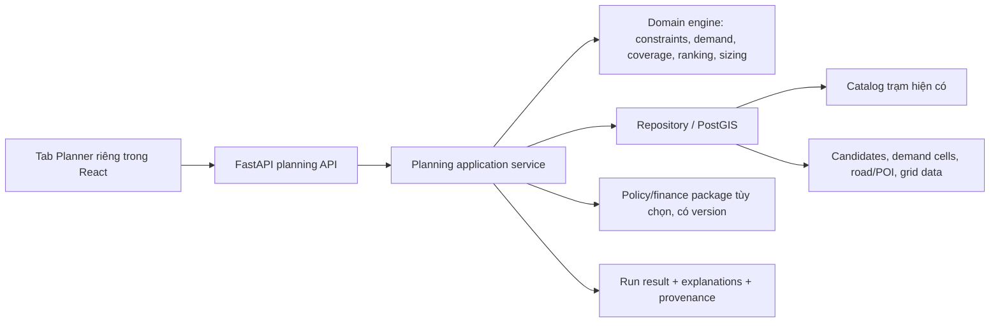

# Kế hoạch triển khai tổng thể hệ thống đề xuất trạm sạc

> Tài liệu định hướng cho team triển khai demo station recommendation trên nền ứng dụng hiện có. Đây là đặc tả kỹ thuật/sản phẩm; các ngưỡng và trọng số đánh dấu tham khảo không phải tiêu chuẩn ngành hay cam kết đầu tư.

## 1. Tóm tắt cho team

Hệ thống giúp đơn vị quy hoạch hoặc đầu tư **sàng lọc và so sánh nơi nên bổ sung trạm sạc ở TP.HCM**, ước lượng quy mô kỹ thuật ban đầu và hiểu vì sao một phương án được xếp cao/thấp. Kết quả phải cho biết cả phần còn thiếu dữ liệu, rủi ro về công suất/lưới và mức thay đổi khi đổi kịch bản.

Sản phẩm MVP là một **công cụ hỗ trợ quyết định kỹ thuật theo kịch bản**, không phải công cụ tự phê duyệt dự án hay cam kết lợi nhuận. Khi có bộ dữ liệu tài chính/chính sách từ đơn vị chuyên môn, hệ thống nhận chúng như package có phiên bản, kiểm tra và chạy lại cùng engine. Khi chưa có, phần tài chính hiển thị unavailable hoặc minh họa được gắn nhãn.

Nhánh `fix/ui` là nền dùng chung mà team muốn giữ cho backend, frontend và database tổng. Bài toán chờ/occupancy tiếp tục thuộc luồng đó. Station recommendation được thêm như một feature/domain riêng, sử dụng catalog và các dữ liệu liên quan qua repository/API hiện có; không tạo bản sao backend, frontend hay database.

## 2. Vấn đề và người dùng

### 2.1 Vấn đề cần giải quyết

- Trạm hiện có có thể tập trung ở nơi đã có giao dịch; dữ liệu giao dịch một mình không thể chỉ ra đầy đủ vùng chưa được phục vụ.
- Nhà đầu tư cần cân bằng nhu cầu tiềm năng, độ phủ, chi phí và năng lực lưới nhưng các dữ liệu đó thường nằm ở nhiều nguồn và có độ tin cậy khác nhau.
- Quy hoạch dân cư, du lịch, đội xe, chính sách hoặc giá điện có thể thay đổi theo thời gian. Một danh sách địa điểm cố định nhanh chóng lỗi thời nếu không biết giả định nào tạo ra nó.
- Trạng thái chờ/occupancy ở trạm hiện hữu cho biết áp lực vận hành tại các điểm quan sát được; nó là một tín hiệu đầu vào hữu ích nhưng không đại diện toàn bộ nhu cầu tiềm ẩn.

### 2.2 Người dùng và lợi ích

| Nhóm | Câu hỏi | Giá trị hệ thống hướng tới |
|---|---|---|
| Đơn vị quy hoạch/chính sách | Khu nào còn thiếu độ phủ? Kịch bản ưu tiên thay đổi danh sách ra sao? | Coverage, nhóm/vùng được phục vụ, các điều kiện và trade-off minh bạch |
| Nhà đầu tư/vận hành | Vị trí nào đáng khảo sát tiếp? Cần loại/cỡ trạm nào? | Sàng lọc ứng viên, áp lực cung-cầu, khả năng triển khai và economics khi có dữ liệu |
| Đội kỹ thuật/lưới điện | Site nào có rủi ro công suất/đấu nối? | Điều kiện lưới, công suất dự kiến, thông tin cần thẩm tra |
| Tài xế/đội xe/cộng đồng | Việc bổ sung trạm có thể cải thiện tiếp cận ở đâu? | Tác động độ phủ và khả năng tiếp cận; chưa phải chức năng định tuyến chuyến đi |

## 3. Phạm vi và ranh giới

**Study area:** TP.HCM theo ranh giới hành chính có hiệu lực sau hợp nhất năm 2025. Geometry, mã vùng, nguồn và ngày hiệu lực phải được pin/version. Demo có thể dùng pilot extent nhỏ hơn, nhưng giao diện và báo cáo phải nêu rõ ranh giới pilot.

**Trong MVP:**

1. Nhận một phạm vi phân tích và tập địa điểm ứng viên (tạo từ lưới/vùng/điểm dữ liệu hoặc nhập thủ công).
2. Đánh giá điều kiện hard constraint: trong study area, khả năng tiếp cận/quyền sử dụng, thông tin an toàn/cấp phép và khả năng điện nếu đã biết. Trạng thái thiếu dữ liệu là `unknown/conditional`, không tự coi là đạt.
3. Tính và xếp hạng ứng viên theo nhu cầu tiềm năng, độ phủ tăng thêm, phù hợp mạng lưới và mức sẵn sàng kỹ thuật; giải thích từng thành phần.
4. Đề xuất dải cấu hình AC/DC, số cổng hoặc kW như **phương án sơ bộ**, kèm rủi ro quá tải và giả định.
5. Nhận policy/finance package tùy chọn; so sánh các run và nêu thay đổi khi package đổi.
6. Gắn provenance, thời điểm, đơn vị, trạng thái `observed/proxy/synthetic/scenario/unknown` và độ phủ bằng chứng.

**Chưa thuộc MVP:** dự báo hành vi của từng xe; điều khiển trạm thời gian thực; route planner cá nhân; tự tạo chính sách/giá/chuẩn lợi nhuận; claim ROI nếu thiếu dữ liệu; city-wide portfolio optimizer nếu chưa có candidate, demand, grid và budget data đủ tốt.

### Phân biệt ba bài toán

| Bài toán | Quyết định | Chủ sở hữu |
|---|---|---|
| Station planning/recommendation (nhánh này) | Đặt mới/nâng cấp trạm ở đâu, quy mô nào? | Module quy hoạch trạm |
| Wait/occupancy forecasting | Trạm hiện có sẽ bận/chờ thế nào? | Luồng/nhánh `fix/ui` theo quyết định của team |
| Trip charging/route recommendation | Xe trong chuyến cụ thể nên sạc ở đâu? | Driver journey; có thể dùng dữ liệu hạ tầng được quy hoạch |

## 4. Đầu ra sản phẩm

Đầu ra là **danh sách phương án địa điểm có giải thích**, không chỉ một heatmap hay một điểm tổng:

- vị trí, loại ứng viên, phạm vi/pilot và thời hạn scenario;
- nhu cầu ước lượng hoặc proxy, nguồn và độ tin cậy bằng chứng;
- độ phủ hiện tại và phần độ phủ/tiếp cận tăng thêm nếu xây tại đây;
- công suất/số cổng đề xuất và giả định về mix AC/DC;
- rủi ro quá tải, grid/site feasibility và hard constraints còn `conditional/unknown`;
- chi phí nếu có input đáng tin; doanh thu, cash flow, payback/NPV chỉ khi package tài chính đủ dữ liệu và có công thức được chủ sở hữu xác nhận;
- điểm thành phần, trọng số/profile, lý do được đề xuất/loại và sensitivity giữa các scenario.

Khi chưa có economics, gọi kết quả là **xếp hạng tiềm năng địa điểm** hoặc **tối ưu nhu cầu và độ phủ dưới ngân sách**, không gọi là tối ưu lợi nhuận.

## 5. Thiết kế hệ thống và tận dụng ứng dụng hiện hữu

- **Frontend:** thêm tab/mode Planner và feature folder riêng; tái sử dụng map provider, design system và API client. Không đưa logic quy hoạch vào component driver/route.
- **Backend:** thêm router `/api/v1/planning` hoặc `/api/v1/investor` (chốt một tên trước khi code), Pydantic request/response và service riêng. Route chỉ validate/gọi service; công thức nằm trong domain module.
- **Database:** tái sử dụng PostgreSQL/PostGIS và catalog/repository hiện có. Chỉ thêm bảng nguồn dữ liệu mới khi cần lưu bền vững; MVP không cần bảng dự án đầu tư hay bảng điểm tạm. Dùng schema/DDL workflow hiện hành của repo, không dựng DB riêng.
- **Data/simulator:** giữ dữ liệu demo tách rõ observed và synthetic. Có thể tận dụng station inventory, topology, schema timing và aggregate pressure signal từ branch cũ nếu xác minh được; không giả định model artifact có sẵn, không biến occupancy synthetic thành nhu cầu TP.HCM.
- **Policy/finance adapter:** nhận package ngoài với source/owner/version/effective date/units/rules. Engine giữ công thức kỹ thuật; công thức economics phải khai báo/được owner xác nhận, không hard-code thành chính sách của team.

Tài liệu thành viên [ideas.md](ideas.md) khảo sát `fix/ui` tại commit `fe2ccd4`; đây là snapshot tham khảo. Trước lúc code phải đối chiếu branch `fix/ui` mới nhất, vì ref đã thay đổi kể từ snapshot đó.

## 6. Dữ liệu, thiếu dữ liệu và độ tin cậy

| Lớp dữ liệu | Dùng để làm gì | MVP/status hiện tại |
|---|---|---|
| Trạm/cổng/công suất/trạng thái/giá | Nguồn cung, tương thích, coverage | Tái dùng catalog; kiểm tra độ đầy đủ, uptime và ngày cập nhật |
| Session/kWh/occupancy/wait | Áp lực quan sát ở nơi đã có trạm | Chỉ là một tín hiệu; phải giữ nhãn synthetic/observed và nguồn |
| Candidate/parcel/site host | Sinh và kiểm tra địa điểm đề xuất | Cần tập ứng viên thật hoặc synthetic có đánh dấu |
| Giao thông, road graph, OD | Nhu cầu dọc hành lang và thời gian tiếp cận | Dùng khi có license/phạm vi; khoảng cách đường chim bay chỉ là proxy baseline |
| Dân cư, nhà ở, sạc tại nhà, POI, tourism, fleet | Nhu cầu tiềm ẩn và profile điểm đến | Scenario/proxy đến khi có dữ liệu phù hợp |
| Điện/lưới/đấu nối | Kích thước và khả năng cấp điện | Unknown nếu chưa có utility/site assessment |
| CAPEX/OPEX/tariff/price/grant/budget | Feasibility/economics/policy | Optional package, không tự điền số thị trường |

Mỗi giá trị cần có unit, thời gian, geography, source, quality, status và `is_synthetic` khi liên quan. `unknown` khác số 0 và khác `not_applicable`. Nếu tiêu chí quan trọng thiếu dữ liệu thì trả `conditional`, giảm evidence coverage hoặc yêu cầu thẩm tra; không cho một candidate điểm cao chỉ vì thiếu tiêu chí bất lợi.

## 7. Các profile và nguyên tắc xếp hạng

Không gộp tất cả stakeholder vào một score mặc định. Cấu hình profile rõ mục tiêu:

1. **Technical opportunity (demo mặc định):** nhu cầu, độ phủ tăng thêm, độ sẵn sàng hạ tầng, phù hợp use case, evidence coverage.
2. **Public/policy:** technical profile cộng hard constraints/targets/equity outcomes do owner cung cấp; báo trade-off riêng.
3. **Investor/economic:** cùng candidate và demand snapshot, cộng finance package được owner xác nhận; mới báo cashflow/payback/NPV.

Hard constraints phải tách khỏi soft score. Điểm/weights trong ma trận hiện hành chỉ là baseline có thể cấu hình để demo, không phải chuẩn ngành hay hiệu chuẩn TP.HCM. Kết quả luôn trả component metrics và score profile/version để UI giải thích. Nếu chọn nhiều site, tính **marginal coverage sau khi chọn các site trước đó** để tránh đề xuất nhiều điểm trùng nhau.

## 8. Hợp đồng chung trước khi chia module

Contract v0.1 và các brief cho người triển khai nằm ở [modules/README.md](modules/README.md). Trước khi chia code cần chốt: tên router, request/response schema, enum trạng thái dữ liệu, units/CRS/timezone, quy tắc unknown, hard-vs-soft constraint, score direction, versioning và cách bàn giao dữ liệu. Các module chỉ mở rộng contract qua PR được review; không tự đổi API hoặc ý nghĩa score.

## 9. Lộ trình theo vertical slice

### Giai đoạn 0 — Khóa baseline và hợp đồng

- Lấy baseline `fix/ui` mới nhất và chạy app theo README của branch đó.
- Kiểm tra endpoint, repository, bảng và map component thực tế; `ideas.md` là snapshot, không phải khẳng định hiện trạng mới nhất.
- Chốt API/data contract, pilot extent TP.HCM, CRS, timezone, candidate source và profile score.
- Chọn một demo dataset nhỏ, gắn nhãn synthetic/proxy và lưu provenance.

**Gate:** tất cả module dùng cùng schema/units/enum; team hiểu rõ dữ liệu demo không phải nhu cầu thị trường.

### Giai đoạn 1 — Danh sách site có thể giải thích

- Nạp candidate set và trạm hiện có; query lân cận bằng PostGIS/repository.
- Loại site đã xác nhận infeasible; để site thiếu bằng chứng ở trạng thái conditional.
- Tính coverage gap/marginal coverage, demand proxy, network fit và evidence coverage.
- API trả top candidates cùng điểm thành phần, constraints và provenance; UI bản đồ/bảng so sánh được ít nhất hai site.

**Gate:** người xem hiểu vì sao một site nằm cao/thấp; đổi scenario tạo run mới và kết quả khác có thể giải thích.

### Giai đoạn 2 — Quy mô trạm và rủi ro công suất

- Sinh/nhận demand scenario theo thời gian và nhóm use case.
- So sánh vài cấu hình cổng/công suất dưới cùng giả định; tính unmet demand/overload risk trong phạm vi mô hình được hỗ trợ.
- Không tái hiện wait forecast của `fix/ui`; nếu dùng wait metric, ghi rõ nguồn/input và giữ ownership của nhánh đó.

**Gate:** cùng input/seed/version cho kết quả tái lập; hiển thị công suất và giả định thay vì chỉ đưa con số khuyến nghị.

### Giai đoạn 3 — Chính sách/tài chính

- Nhận packages có owner/source/version/effective date và validation.
- Chạy lại cùng data snapshot dưới nhiều policy/finance package, nêu delta và sensitivity.
- Chỉ tính metric economics mà input đủ và finance owner xác nhận; không làm financial policy thay doanh nghiệp.

**Gate:** thay package tạo kết quả mới có lineage và metric giải thích được.

### Giai đoạn 4 — Portfolio, lưu dự án và vận hành

- Tối ưu chọn nhiều site dưới ngân sách/công suất/coverage constraints khi dữ liệu đủ.
- Lưu scenario/run/project nếu cần audit hoặc nhiều phiên; thiết kế quyền truy cập/retention trước khi thêm.
- Bổ sung cập nhật dữ liệu định kỳ, backtest, uncertainty, fairness/accessibility và monitoring drift.

## 10. Chia module và cách làm song song

Các brief chi tiết sẵn sàng làm prompt nằm trong `modules/`:

| Module | Phạm vi sở hữu | File brief |
|---|---|---|
| M1 — Data & GIS | Data source, HCMC boundary, candidate/demand dataset, provenance/validation | [M1_DATA_GIS_VI.md](modules/M1_DATA_GIS_VI.md) |
| M2 — Recommendation engine | Hard constraints, metrics, ranking, coverage, sizing interface | [M2_RECOMMENDATION_ENGINE_VI.md](modules/M2_RECOMMENDATION_ENGINE_VI.md) |
| M3 — Backend & DB integration | API/router, service/repository, PostGIS integration, optional persistence | [M3_BACKEND_DB_VI.md](modules/M3_BACKEND_DB_VI.md) |
| M4 — Frontend Planner | Tab/mode, map selection, ranking/explanation, scenarios | [M4_FRONTEND_PLANNER_VI.md](modules/M4_FRONTEND_PLANNER_VI.md) |
| M5 — Demo & integration | Seed scenarios, end-to-end behavior, labels, acceptance and handoff | [M5_DEMO_INTEGRATION_VI.md](modules/M5_DEMO_INTEGRATION_VI.md) |

Phụ thuộc chính: M1 cung cấp data contract/sample → M2 implement engine trên contract → M3 expose API → M4 gọi API và trình bày → M5 nối data/demo và chạy acceptance. Có thể làm song song M1/M4 skeleton/M3 scaffolding, nhưng không tạo logic giả cạnh tranh với contract. Mỗi module brief chứa đầu vào, đầu ra, giới hạn, task nhỏ và acceptance riêng.

## 11. Quy ước Git/merge đề xuất

1. `fix/ui` là shared app baseline/source of truth; xác minh commit mới nhất trước khi tạo integration work.
2. Tạo một feature branch dựa trên `fix/ui` cho phần code station planning; tạo nhánh con ngắn hạn cho từng module nếu cần review độc lập.
3. Mọi module dùng cùng contract commit đầu tiên. PR nhỏ, chỉ sửa file trong ownership, ghi rõ contract change nếu cần.
4. Không cho các agent tự sửa router/schema/DB contract đồng thời. Một người giữ vai trò integration owner để resolve contract.
5. Merge feature PR trở lại `fix/ui`; không merge ngược toàn bộ `fix/ui` vào nhánh tài liệu hiện tại như một cách tích hợp.
6. Dữ liệu lớn/nhạy cảm không commit nếu không được phép; commit sample nhỏ và synthetic minh bạch.

Hiện nhánh tài liệu station recommendation và `fix/ui` đã phân kỳ. Để triển khai sát ứng dụng, nên bắt đầu worktree/branch code từ `origin/fix/ui` mới nhất rồi mang các contract/docs cần thiết sang; đây là hướng dễ merge và không nhân đôi nền app. Hãy kiểm tra các tài liệu và local edits trước khi thay đổi branch đang dùng.

## 12. Rủi ro và tiêu chí demo thành công

### Rủi ro cần nói rõ

- Catalog thiếu/cũ làm coverage gap sai.
- Synthetic occupancy làm người xem hiểu nhầm thành số liệu thật.
- Candidate được chọn từ vị trí dễ có dữ liệu gây selection bias.
- Grid/land/legal feasibility thường không suy ra được chỉ từ tọa độ.
- Score phụ thuộc weights; candidate có coverage dữ liệu thấp có thể xếp hạng bất ổn.
- Revenue và payback phụ thuộc tariff, demand charges, CAPEX/OPEX và contract cụ thể.

### Demo được coi là đạt khi

- Người dùng chạy được một scenario ở pilot TP.HCM và nhận danh sách site/công suất sơ bộ có giải thích.
- So sánh ít nhất hai site dưới cùng data snapshot; nhìn thấy coverage tăng thêm, constraints, risk, costs nếu có và missing data.
- Thay một đầu vào hoặc profile làm kết quả thay đổi có thể giải thích và tái lập.
- UI/API phân biệt observed, proxy, synthetic, scenario và unknown xuyên suốt.
- Luồng tài xế hiện hữu tiếp tục hoạt động; planner được tách thành feature/module riêng.

## 13. Hướng phát triển

Khi có dữ liệu thật, thay proxy bằng session, OD/traffic, fleet, population/home charging, land/grid/cost data có license và quality. Khi có policy package, hỗ trợ equity/coverage targets và effective dates. Khi finance owner cấp giả định/công thức, tính economics theo package. Khi candidate/data đủ tốt, chuyển từ xếp hạng đơn lẻ sang portfolio optimization và sensitivity/uncertainty. Khi hạ tầng đã được quy hoạch, kết quả có thể cung cấp một phần dữ liệu cho bài toán vận hành hoặc route recommendation, nhưng không nhập nhằng với quyết định của từng chuyến đi.

## Tài liệu liên quan

- [Problem blueprint](PROBLEM_BLUEPRINT_VI.md)
- [Data plan](DATA_PLAN_VI.md)
- [Simulation/demo plan](SIMULATION_AND_DEMO_PLAN_VI.md)
- [Constraint matrix](CONSTRAINT_MATRIX_HCMC_VI.md)
- [Scenario JSON Schema](schemas/planning-scenario.schema.json)
- [Ý tưởng kỹ thuật thành viên](ideas.md)
