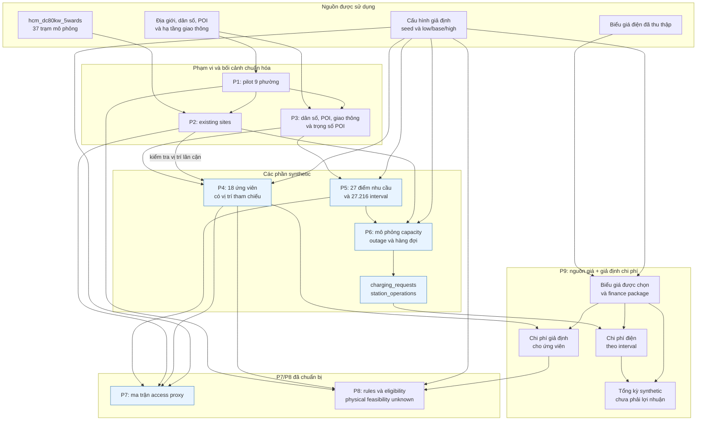
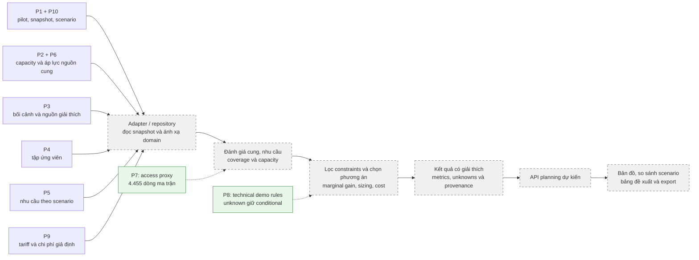

# Tổng kết dữ liệu chuẩn hóa và luồng sử dụng cho station planning

Cập nhật: **13/10/2026**. Snapshot: **`hcmc-nine-wards-demo-v3`**, seed **`20261013`**.

Bộ dữ liệu đã chuẩn bị phục vụ demo quy hoạch trạm sạc trong pilot 9 phường. Các phần 1–10 đã có đặc tả/output cho demo. P7 có ma trận access proxy; P8 có package quy tắc và kết quả eligibility. Physical feasibility vẫn unknown theo cách xử lý đã chốt. Engine xếp hạng, API và tích hợp DB/UI chưa được triển khai từ snapshot này.

- Quyết định P7/P8: [P7_P8_DECISIONS_VI.md](P7_P8_DECISIONS_VI.md). Snapshot v1/v2 cùng báo cáo tương ứng được lưu trong Git stash local `archive station-planning demo v1-v2 before publishing v3`, không nằm trong bộ dữ liệu được push.
- Thư mục snapshot: [`data_platform/station_planning/demo_hcmc_v3`](../../data_platform/station_planning/demo_hcmc_v3/).
- Hướng dẫn tạo lại: [README dữ liệu](../../data_platform/station_planning/README.md).
- Tham số sinh: [`config/station_planning_demo.json`](../../config/station_planning_demo.json).
- Kế hoạch nguồn dữ liệu: [DATA_PLAN_VI.md](DATA_PLAN_VI.md).

## 1. Phạm vi và quyết định nguồn

Pilot gồm **Sài Gòn, Bến Thành, Xuân Hòa, Tân Định, Phú Nhuận, Bình Thạnh, Tân Sơn Hòa, Thạnh Mỹ Tây và Bình Quới**, theo lớp địa giới `ADMINISTRATIVE_2025` đã chọn. Ngày hiệu lực pháp lý của geometry và ngày thống kê dân số vẫn để unknown.

| Phần | Quyết định đã áp dụng | Trạng thái |
|---|---|---|
| 1 — Phạm vi | Lấy 9 polygon nguồn, tạo polygon hợp làm pilot | Đã chuẩn bị |
| 2 — Existing sites | Dùng đúng `hcm_dc80kw_5wards`: 37 trạm mô phỏng tại 9 phường, dù tên file còn `5wards` | Đã chuẩn hóa |
| 3 — Bối cảnh | Lọc dân số, POI và giao thông đã thu thập về pilot | Đã chuẩn bị |
| 4 — Candidates | Synthetic hoàn toàn, có vị trí tham chiếu từ POI/bãi xe và ngữ cảnh hạ tầng | Đã sinh |
| 5 — Nhu cầu | Synthetic hoàn toàn, có cấu trúc không gian, giờ và ngày | Đã sinh |
| 6 — Vận hành | Synthetic hoàn toàn, nhất quán với nhu cầu và capacity của existing sites | Đã sinh |
| 7 — Tiếp cận | Haversine × 1,3; tốc độ fast/normal/slow 25/20/12 km/h, cộng 2 phút, ngưỡng 15 phút | Đã tạo 4.455 dòng matrix |
| 8 — Ràng buộc/chính sách | Technical demo package; giữ physical feasibility unknown/conditional, tắt public-policy overlay | Đã tạo 180 constraint results và 18 eligibility summaries |
| 9 — Tài chính | Biểu giá đã thu thập + chi phí và hệ số kinh tế giả định | Đã chuẩn bị package và bảng tính kỳ demo |
| 10 — Metadata | Ghi nguồn thực tế, units, seed, versions, hash và kiểm tra | Đã chuẩn bị |

`ref.kml` được loại khỏi mọi bước đọc dữ liệu, bổ sung thuộc tính và tính toán. Bộ 668 trạm không được ghép vào run mặc định. Nguồn cung nền là fixture mô phỏng; khoảng trống so với fixture không phải bằng chứng thiếu trạm ngoài thực tế.

## 2. Danh mục các file chuẩn hóa

V3 bổ sung các field/view để khớp DATA_PLAN: `power_kw` cấp site, `source_url` có status, candidate type `parcel` synthetic với subtype cũ, `demand_observations.csv` (37.296 dòng), `demand_cells.csv` (9.072 dòng), mapping node → phường, boundary/scenario/finance metadata và schema máy kiểm tra. Xem [bảng đối chiếu chi tiết](DATA_PLAN_ALIGNMENT_VI.md). Các view mới không phải thêm nhu cầu/nguồn quan sát để cộng với dữ liệu cũ. `scenario.json` giữ schema riêng; `scenario_config.json` là view theo DATA_PLAN.

Các đường dẫn dưới đây trỏ vào snapshot đã tạo. Số dòng không tính header CSV. CSV và GeoJSON của cùng bảng là hai cách biểu diễn cùng dữ liệu, không phải hai tập độc lập.

### 2.1. Phạm vi, nguồn cung và bối cảnh

| Phần | File | Quy mô | Nội dung chính | Vai trò |
|---|---|---:|---|---|
| 1 | [pilot_units.geojson](../../data_platform/station_planning/demo_hcmc_v3/pilot_units.geojson) | 9 polygon | `unit_id`, tên/loại đơn vị, dân số và geometry nguồn | Gán vùng cho các đối tượng; tổng hợp theo phường |
| 1 | [pilot_extent.geojson](../../data_platform/station_planning/demo_hcmc_v3/pilot_extent.geojson) | 1 feature | Geometry hợp của 9 phường, danh sách `unit_ids` | Lọc điểm, cắt tuyến và giới hạn metric demo |
| 2 | [existing_sites.csv](../../data_platform/station_planning/demo_hcmc_v3/existing_sites.csv), [GeoJSON](../../data_platform/station_planning/demo_hcmc_v3/existing_sites.geojson) | 37 trạm | ID EVC, tọa độ, số cổng, 80 kW/cổng giả định, giờ mở cửa, provenance | Capacity nền, mô phỏng vận hành, kiểm tra vị trí ứng viên |
| 3 | [population.csv](../../data_platform/station_planning/demo_hcmc_v3/population.csv) | 9 dòng | Dân số nguồn, `unit_id`, ngày thống kê unknown | Ngữ cảnh để sinh nhu cầu theo vùng |
| 3 | [context_poi.geojson](../../data_platform/station_planning/demo_hcmc_v3/context_poi.geojson) | 3.708 POI | ID nguồn, tên, category, tọa độ, `pilot_unit_id` | Đặc trưng điểm đến, vị trí tham chiếu và cụm nhu cầu |
| 3 | [context_transport.geojson](../../data_platform/station_planning/demo_hcmc_v3/context_transport.geojson) | 1.640 đối tượng | Điểm/tuyến hạ tầng; tuyến cắt theo pilot; danh sách vùng giao nhau | Ngữ cảnh tiếp cận và proxy hạ tầng giao thông |
| 3 | [poi_model_weights.csv](../../data_platform/station_planning/demo_hcmc_v3/poi_model_weights.csv) | 3.708 dòng | `feature_id`, nhóm nghi trùng, trọng số mô hình | Giảm nguy cơ đếm lặp khi tạo đặc trưng |

Có **30 nhóm POI nghi trùng** trong pilot. Giữ toàn bộ bản ghi nguồn; trong mô hình, mỗi nhóm có tổng trọng số bằng 1. Đây là xử lý proxy thận trọng, chưa phải xác nhận các bản ghi thuộc cùng một cơ sở thực tế.

### 2.2. Các phần synthetic

| Phần | File | Quy mô | Nội dung chính | Vai trò |
|---|---|---:|---|---|
| 4 | [candidate_sites.csv](../../data_platform/station_planning/demo_hcmc_v3/candidate_sites.csv), [GeoJSON](../../data_platform/station_planning/demo_hcmc_v3/candidate_sites.geojson) | 18 ứng viên, 2/phường | ID, POI tham chiếu, lý do sinh, khoảng cách tới trạm fixture, traffic scenario, feasibility unknown | Tập phương án đầu vào cho engine sau này |
| 5 | [demand_nodes.csv](../../data_platform/station_planning/demo_hcmc_v3/demand_nodes.csv), [GeoJSON](../../data_platform/station_planning/demo_hcmc_v3/demand_nodes.geojson) | 27 điểm, 3/phường | ID điểm hỗ trợ nhu cầu, tọa độ, trọng số phân bổ dân số và POI | Phân bố không gian của demand synthetic |
| 5 | [demand_intervals.csv](../../data_platform/station_planning/demo_hcmc_v3/demand_intervals.csv) | 27.216 dòng | Profile, điểm nhu cầu, khung giờ, expected sessions, session count, kWh | So sánh nhu cầu low/base/high theo không gian-thời gian |
| 6 | [station_operations.csv](../../data_platform/station_planning/demo_hcmc_v3/station_operations.csv) | 37.296 dòng | Cổng khả dụng, occupied peak/mean, outage, arrivals, queue, completed/abandoned, kWh | Tín hiệu áp lực/capacity giả lập tại trạm hiện hữu |
| 6 | [charging_requests.csv](../../data_platform/station_planning/demo_hcmc_v3/charging_requests.csv) | 24.410 yêu cầu | Request ID, cell/site, arrival/start/end, trạng thái, thời gian chờ, kWh yêu cầu/giao | Đối soát demand với vận hành và năng lượng |

**Ứng viên:** lấy vị trí từ POI/bãi xe phù hợp; cách trạm fixture ít nhất **150 m**, cách ứng viên đã chọn ít nhất **250 m**. Các ngưỡng này là tham số sinh demo. Khoảng cách lọc vị trí là great-circle screening; P7 dùng thêm ma trận proxy đã chuẩn bị, không phải routing. Đất, điện, quyền tiếp cận và cấp phép vẫn unknown; mọi ứng viên có trạng thái `conditional`.

**Giao thông cao:** gán scenario/proxy từ số đối tượng hạ tầng trong bán kính cấu hình. Không có lưu lượng xe đo được trong nguồn, nên không gọi các nhãn này là traffic thực tế. Tọa độ POI có nguồn không làm phương án xây trạm synthetic trở thành địa điểm đã xác minh khả thi.

**Nhu cầu:** các điểm hỗ trợ được chọn độc lập với ứng viên. Trọng số dân số cộng thành 1 trong mỗi phường. Đây là các cụm điểm synthetic, không phải lưới polygon hay mô hình dự báo đã huấn luyện.

**Vận hành:** yêu cầu của một phường được phân bổ vào các trạm cùng phường theo trọng số số cổng. Đây là quy tắc mô phỏng, chưa giải quyết hành vi chọn trạm hoặc định tuyến. `completed` đã được phục vụ; `abandoned` và `pending` không có điện năng giao cho xe.

### 2.3. P7/P8 đã chốt

| Phần | File | Quy mô | Vai trò |
|---|---|---:|---|
| 7 | [access_matrix.csv](../../data_platform/station_planning/demo_hcmc_v3/access_matrix.csv), [access_model.json](../../data_platform/station_planning/demo_hcmc_v3/access_model.json) | 4.455 dòng | 27 demand nodes × 55 mục tiêu × 3 access profiles; có cả cặp khác phường |
| 8 | [technical_constraints_package.json](../../data_platform/station_planning/demo_hcmc_v3/technical_constraints_package.json) | 1 package | Option DC 4 × 80 kW, budget 10 tỷ, utilization target 0,8, evidence threshold 0,6, weights và unknown handling |
| 8 | [candidate_constraints.csv](../../data_platform/station_planning/demo_hcmc_v3/candidate_constraints.csv) | 180 dòng | 18 ứng viên × 10 gates; mỗi gate có value/status/reason/source |
| 8 | [candidate_eligibility.csv](../../data_platform/station_planning/demo_hcmc_v3/candidate_eligibility.csv) | 18 dòng | Tất cả conditional: 5 gates pass, 5 physical gates unknown; chưa ready-to-build |

Baseline `normal`: haversine × 1,3 / 20 km/h + 2 phút, trong ngưỡng nếu ≤ 15 phút. Fast/slow dùng 25/12 km/h, độc lập với demand low/base/high. Ma trận chỉ là proxy địa lý; phải áp opening hours, availability, capacity và compatibility riêng. Không gọi proxy là đường đi hoặc thời gian thực tế.

Chốt P8 không tạo bằng chứng đất/điện/permit. Các rule vật lý giữ unknown nếu thiếu source evidence, metric unknown không bị biến thành 0. Rule budget tổng và evidence threshold được áp ở engine sau; bảng hiện tại chỉ kiểm tra từng ứng viên. Xem [quyết định P7/P8](P7_P8_DECISIONS_VI.md) để biết công thức, threshold và cách diễn giải.

### 2.4. Tài chính và chi phí

| File | Quy mô | Nội dung | Sử dụng |
|---|---:|---|---|
| [selected_electricity_tariffs.csv](../../data_platform/station_planning/demo_hcmc_v3/selected_electricity_tariffs.csv) | 10 khoảng giờ | Một schedule và một cấp điện áp, giá trước VAT/có VAT, provenance | Ghép đơn giá đúng với mỗi interval mua điện |
| [finance_package.json](../../data_platform/station_planning/demo_hcmc_v3/finance_package.json) | 1 package | Inputs có units/status: budget, CAPEX/OPEX, thuê, đấu nối, giá bán và hệ số | Đầu vào economics theo giả định demo |
| [candidate_cost_assumptions.csv](../../data_platform/station_planning/demo_hcmc_v3/candidate_cost_assumptions.csv) | 54 dòng | 18 ứng viên × 3 mức chi phí; cấu hình tài chính tham chiếu 4 cổng | So sánh cost assumptions; chưa phải sizing recommendation |
| [electricity_cost_intervals.csv](../../data_platform/station_planning/demo_hcmc_v3/electricity_cost_intervals.csv) | 37.296 dòng | Điện giao, điện mua, tariff period, giá và chi phí từng slot | Đối soát OPEX điện với vận hành synthetic |
| [finance_period_summary.csv](../../data_platform/station_planning/demo_hcmc_v3/finance_period_summary.csv) | 3 dòng | Tổng năng lượng/chi phí điện và doanh thu giả định theo profile | So sánh kỳ demo; không phải lợi nhuận hoặc ROI |

Biểu giá chọn `tt16_reference_2025`, cấp điện áp `lt_6kv`. Việc chọn cấp điện áp là giả định, không suy ra từ 80 kW DC. Giá nguồn giữ trạng thái tham chiếu lịch sử; không khẳng định đây là giá/lịch đang áp dụng cho trạm năm 2026.

Các phép tính đã dùng:

```text
Điện mua từ lưới = điện giao cho xe / hiệu suất giả định 0,93
Chi phí điện trước VAT = điện mua trong slot × đơn giá nguồn của slot
Doanh thu minh họa = điện giao cho xe × giá bán giả định
Revenue minus electricity = doanh thu minh họa − chi phí điện trước VAT
```

Dòng cuối chưa trừ thuê đất, nhân sự, bảo trì, khấu hao và các chi phí khác. NPV/payback để unavailable; không ngoại suy một tuần synthetic thành doanh thu năm. Package/bảng chi phí đã có, nhưng finance engine trong `scenario.json` vẫn disabled vì chưa tích hợp adapter và metric đầu tư.

### 2.5. Cấu hình, metadata và kiểm tra

| File | Vai trò |
|---|---|
| [generation_config.json](../../data_platform/station_planning/demo_hcmc_v3/generation_config.json) | Bản cấu hình đã dùng: nguồn, seed, phân phối, các hệ số, P7/P8 và các input còn unknown |
| [scenario.json](../../data_platform/station_planning/demo_hcmc_v3/scenario.json) | Scenario đã gắn snapshot ID, pilot và giả định demand/finance; schema version 1.1, scenario version 7 |
| [data_dictionary.json](../../data_platform/station_planning/demo_hcmc_v3/data_dictionary.json) | Ý nghĩa các bảng, đơn vị, timezone và cách hiểu unknown |
| [manifest.json](../../data_platform/station_planning/demo_hcmc_v3/manifest.json) | Hash nguồn/output, script/template/config, thư viện và quy tắc xử lý geometry |
| [validation_report.json](../../data_platform/station_planning/demo_hcmc_v3/validation_report.json) | Kiểm tra lúc sinh, số bản ghi và tổng theo scenario |
| [verification_report.json](../../data_platform/station_planning/verification_report.json) | Kết quả đối soát độc lập, JSON Schema, helper tests, lint và tái lập |

## 3. Sơ đồ chuẩn bị dữ liệu đã thực hiện

Sơ đồ này mô tả các bước đã có trong script chuẩn bị dữ liệu. Nó không mô tả một lần chạy recommendation engine.



Phần 10 ghi metadata, hash và validation cho toàn bộ các output trên. Các raw inputs được giữ nguyên. Nhu cầu không phụ thuộc vào thứ hạng hoặc nhãn “ứng viên tối ưu”; tập ứng viên và demand được tạo riêng để tránh vòng lặp tự chứng minh.

## 4. Sơ đồ sử dụng dữ liệu trong hệ thống dự kiến

Luồng dưới đây là thiết kế tích hợp tiếp theo. P7/P8 đã có dữ liệu, nhưng các khối engine/API/UI vẫn chưa được triển khai từ snapshot này.



### Dữ liệu đi vào từng phép tính

| Phép tính/chức năng dự kiến | Input cần dùng | Kết quả mong đợi | Trạng thái hiện tại |
|---|---|---|---|
| Hiển thị bản đồ và kiểm tra phạm vi | P1, P2, P3, P4, P5 dạng GeoJSON | Layers trạm/ứng viên/nhu cầu/bối cảnh cùng pilot | File đã có; chưa tích hợp UI |
| Xác định nhu cầu được phục vụ bởi trạm hiện hữu | P2 + P5 + P6 + P7 | Coverage nền, unmet demand theo capacity và khả năng tiếp cận | P7 đã có; chờ engine |
| Tính đóng góp của ứng viên | P4 + P5 + P7 + nguồn cung nền | Nhu cầu/coverage tăng thêm, tránh tính overlap nhiều lần | P7 đã có; chờ engine |
| Đề xuất quy mô cổng/công suất | P5 + P6 + mục tiêu dịch vụ thuộc P8 | Phương án capacity có giả định và giới hạn | Chưa thực hiện sizing |
| Lọc phương án khả thi | P4 + P8 | Pass/fail/conditional cùng lý do | Có bảng kiểm tra; physical feasibility unknown/conditional |
| So chi phí dưới budget | P4 + P9 + portfolio được chọn | CAPEX/OPEX scenario, trade-off với coverage | Có input/bảng giả định; chưa chọn portfolio |
| Tính OPEX điện tại trạm mô phỏng | Điện giao từ P6 + efficiency giả định + tariff P9 | Điện mua và chi phí đúng từng khoảng giá | Đã tính cho tuần demo |
| So sánh và giải thích scenario | P10 + metric/output của engine | Delta, score breakdown, lineage và dữ liệu thiếu | Snapshot/provenance đã có; ranking chưa có |

Endpoint dự kiến trong contract hiện tại: `POST /api/v1/planning/recommendations`. Snapshot được đọc qua adapter/repository; domain engine tính toán, backend trả kết quả, frontend trình bày. Frontend không tự tính score hoặc thay đổi provenance.

## 5. Khóa liên kết giữa các bảng

| Khóa | Liên kết | Ý nghĩa |
|---|---|---|
| `unit_id` | Pilot/population ↔ sites/candidates/demand nodes | Cùng đơn vị không gian; context dùng `pilot_unit_id` hoặc `pilot_unit_ids` |
| `feature_id` / `context_feature_id` | POI/transport ↔ candidate/demand node; POI ↔ modeling weights | Truy vết vị trí và bối cảnh nguồn |
| `cell_id` | Demand node ↔ demand interval ↔ charging request | Truy vết nguồn của yêu cầu synthetic |
| `site_id` | Existing site ↔ charging request ↔ operations ↔ electricity cost | Truy vết capacity và vận hành của một trạm |
| `candidate_id` | Candidate ↔ candidate cost assumptions | Ghép phương án vị trí với chi phí giả định |
| `scenario_profile` + timestamp | Demand/requests/operations/cost | Giữ low/base/high và từng interval tách biệt |
| `request_id` | Ledger yêu cầu | Phân biệt completed/abandoned/pending và đối soát năng lượng |
| `schedule_id`, `voltage_band_id`, ngày/giờ | Selected tariff ↔ electricity cost | Chọn đúng một lịch, cấp điện áp và đơn giá |
| `data_snapshot_id` | Scenario ↔ manifest ↔ run tương lai | Tái lập kết quả với đúng phiên bản input |

Đối soát nhu cầu dùng `(scenario_profile, cell_id, arrival_time)` từ ledger với `(scenario_profile, cell_id, interval_start)` của demand. Đối soát phiên hoàn thành dùng `start_time` để ghép vào operation/cost slot của trạm. Không join các profile vào một chuỗi vận hành chung.

## 6. Thời gian, đơn vị và giới hạn diễn giải

- Lịch synthetic: **07–13/07/2025**, 7 ngày, bước **30 phút**, timezone **Asia/Ho_Chi_Minh**. Mốc này phục vụ biểu giá lịch sử đã chọn; không phải dữ liệu quan sát/replay năm 2025. Context thu thập năm 2026 vẫn chỉ là bối cảnh.
- Các số dòng time series ở trên bao gồm **ba kịch bản độc lập**. Không cộng chúng để kết luận một tuần có tổng nhu cầu gấp ba.
- Tọa độ: kinh/vĩ độ; khoảng cách screening: m; công suất: kW/cổng; năng lượng: kWh; thời gian chờ: phút; chi phí: VND, các mục annual là VND/năm.
- CSV dùng UTF-8 BOM; ô trống là unknown. JSON dùng `null`. Unknown không được thay bằng 0.
- Công suất 80 kW/cổng, EV share, home charging, phân phối điện năng và các số tài chính là giả định demo. Connector, grid/land/access/permit chưa được chứng minh.
- Occupied peak và occupied mean có ý nghĩa khác nhau. Mô hình phục vụ tối đa một yêu cầu/cổng/slot, phiên được phục vụ hoàn tất trong slot; không tự coi occupancy này là nhãn huấn luyện thực tế.
- Bộ hiện tại hỗ trợ kiểm thử pipeline và khám phá scenario. Chưa đủ để khẳng định địa điểm tối ưu, ROI hoặc coverage thực tế toàn TP.HCM.

## 7. Kết quả kiểm tra và phần còn lại

[Báo cáo kiểm tra độc lập](../../data_platform/station_planning/verification_report.json) ghi **PASS** cho hash nguồn/output, ID/scope, phân bổ dân số, đối soát demand–requests–operations, giới hạn cổng, timestamp, queue, biểu giá và chi phí. Có kiểm tra đủ cặp P7, công thức proxy, provenance và việc P8 giữ unknown/conditional. V3 bổ sung schema validation cho 46.423 dòng CSV chuẩn và ba JSON metadata/package, cùng đối soát cells/observations/mapping. JSON Schema của template/scenario/rules, 19 helper tests và lint đã qua. Tạo lại với cùng seed cho manifest và output hashes giống nhau. Báo cáo v1/v2 được lưu cùng snapshot lịch sử trong Git stash local nêu trên.

Các việc cần quyết định/triển khai tiếp:

1. Nạp **P7 đã chốt** qua adapter; khi có road graph đủ chất lượng, thay bằng routing thật trong một snapshot/version mới. Giữ nhãn proxy cho baseline hiện tại.
2. Áp **P8 đã chốt** trong engine: unknown → conditional, budget tổng khi chọn portfolio, evidence threshold 0,6 và weights 30/25/20/15/10. Bổ sung physical feasibility có nguồn khi có đối tác.
3. Tích hợp snapshot qua adapter vào engine để đánh giá coverage, capacity, cost và xếp hạng có giải thích.
4. Tích hợp API/UI, so sánh scenario và export theo shared contract; không coi bảng chi phí đã chuẩn bị là kết quả chọn danh mục đầu tư.

Schema DATA_PLAN đã bổ sung trong v3; P7/P8 đã chốt; các bước trên là phần tích hợp tiếp theo của bài toán; snapshot dữ liệu đã chuẩn bị vẫn có thể được sử dụng độc lập để kiểm tra các giả định và giao diện dữ liệu.
