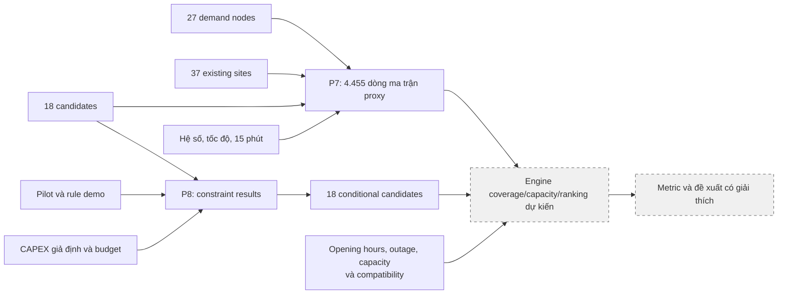

# Chốt P7 và P8 cho demo station planning

Ngày chốt: **13/10/2026**. Snapshot hiện hành: **`hcmc-nine-wards-demo-v3`** tại [`data_platform/station_planning/demo_hcmc_v3`](../../data_platform/station_planning/demo_hcmc_v3/). Snapshot v1/v2 cùng báo cáo tương ứng được lưu trong Git stash local `archive station-planning demo v1-v2 before publishing v3`, không được push. Existing sites vẫn là 37 trạm mô phỏng, 18 ứng viên và 27 điểm nhu cầu trong 9 phường; không đọc `ref.kml`.

## P7 — Ma trận tiếp cận bằng proxy địa lý

**Chọn baseline tính từ tọa độ**, vì lớp giao thông thu thập chưa phải mạng đường hoàn chỉnh để định tuyến và chưa có tốc độ/lưu lượng quan sát.

```text
distance_geodesic_m = haversine(demand_node, target)
distance_proxy_m = distance_geodesic_m × 1,3
travel_minutes_proxy = distance_proxy_m / 1000 / speed_kmh × 60 + 2
within_access_target = travel_minutes_proxy ≤ 15
```

| Tham số | Giá trị chốt | Ý nghĩa |
|---|---:|---|
| Hệ số vòng đường | 1,3 | Giả định đường đi dài hơn khoảng cách địa lý |
| Phụ phí tiếp cận | 2 phút | Thời gian giả định để vào địa điểm/đỗ xe; cùng vị trí vẫn có 2 phút |
| Profile `normal` | 20 km/h | Baseline mặc định |
| Profile `fast` | 25 km/h | Sensitivity tiếp cận nhanh hơn |
| Profile `slow` | 12 km/h | Sensitivity tiếp cận chậm hơn |
| Ngưỡng phục vụ | 15 phút, có tính bằng ngưỡng | Mục tiêu demo, không phải chuẩn pháp lý hoặc ngành |

Ma trận gồm **27 × (37 + 18) × 3 = 4.455 dòng**, đầy đủ cặp demand node → existing site/candidate, kể cả khác phường. `access_profile` độc lập với `scenario_profile` nhu cầu: không mặc định low đi với fast hoặc high đi với slow.

Output:

- [access_model.json](../../data_platform/station_planning/demo_hcmc_v3/access_model.json): phiên bản phương pháp, tham số và giới hạn.
- [access_matrix.csv](../../data_platform/station_planning/demo_hcmc_v3/access_matrix.csv): `cell_id`, `target_id`, `target_type`, `access_profile`, khoảng cách địa lý/proxy, thời gian proxy và cờ trong ngưỡng.

Mọi thời gian/khoảng cách proxy mang `source_type=scenario`, `value_status=illustrative`. `road_connectivity_status` và connector compatibility vẫn unknown. Không diễn giải đường chim bay qua sông hoặc đường cấm thành đường đi hợp lệ. Ma trận chỉ biểu diễn **khả năng tiếp cận giả định**, không bao gồm capacity, opening hours, outage hoặc xác nhận connector.

Engine sau này phải ghép P2/P6 và các điều kiện compatibility vào P7 trước khi gọi một nhu cầu là đã được phục vụ. Độ phủ nhiều site lấy hợp tập node có thể phục vụ; marginal gain phải khấu trừ existing sites và các site đã chọn. Chưa tính portfolio/ranking trong bước chốt này.

Phân bổ request theo phường và số cổng của P6 vẫn là cơ chế mô phỏng riêng, không được coi là kết quả routing theo P7. Ngưỡng 150 m loại vị trí trùng trạm và 250 m giữa candidates là tham số sinh tập ứng viên, không thay thế ngưỡng phục vụ 15 phút.

## P8 — Gói ràng buộc và cấu hình kỹ thuật demo

### Các giả định đã chốt

| Nhóm | Quyết định |
|---|---|
| Cấu hình kỹ thuật thử nghiệm | DC, 4 cổng × 80 kW/cổng; tổng 320 kW là công suất yêu cầu theo scenario, không phải công suất điện được cấp |
| Mục tiêu sizing | Utilization tối đa 0,8 theo scenario; chưa chạy sizing hoặc cam kết SLA chờ |
| Ngân sách portfolio | 10.000.000.000 VND, lấy `base_cost`; kiểm tra tổng khi chọn portfolio |
| Unknown feasibility | Giữ `conditional`, cho phép screening có cảnh báo; không gọi ready-to-build |
| Fail | Loại ứng viên/cấu hình vi phạm rule demo đã tính được, hoặc có bằng chứng infeasible được xác nhận |
| Score weights | Demand 30, marginal coverage 25, grid/site readiness 20, segment fit 15, network gap 10 |
| Evidence threshold | Tổng trọng số thành phần có metric hợp lệ / 100 phải đạt ít nhất 0,6 để đưa vào ranking |
| Unknown score | Bỏ thành phần unknown khỏi cả tử và mẫu; trả phần trọng số thiếu, không thay bằng 0 |
| Public-policy overlay | Tắt; không tự tạo luật cấp phép, equity target hoặc trợ cấp |

Các giá trị là **giả định kỹ thuật và tài chính cho demo**, có owner `student-team`, version và nguồn trong config. Không phải ngưỡng đã được hiệu chỉnh từ thị trường. Utilization target khác ngưỡng bỏ hàng đợi 60 phút của mô phỏng P6; không suy rằng P6 đã đáp ứng mục tiêu dịch vụ này.

### Kiểm tra từng ứng viên

| Rule | Khi nào pass/fail? | Dữ liệu chưa biết |
|---|---|---|
| `valid_geometry` | Tọa độ hữu hạn và đúng range; không hợp lệ thì fail | Không tự đặt tọa độ |
| `inside_pilot` | Nằm trong pilot; ngoài pilot thì fail cho run này | Không suy phạm vi từ tên địa chỉ |
| `new_site_fixture_spacing` | Đạt khoảng cách demo 150 m với existing sites; vi phạm thì fail | Gap nói về fixture, không phải inventory thực |
| `technical_option` | Loại DC, số cổng/công suất dương; cấu hình không hợp lệ thì fail | Không xác nhận layout/connector thực tế |
| `land_site_control` | Chỉ pass/fail khi có giá trị và bằng chứng nguồn cấp quyền/không cấp quyền | Unknown → conditional |
| `grid_capacity` | So công suất được xác nhận với 320 kW scenario | Unknown → conditional; không coi số chi phí đấu nối là bằng chứng điện khả dụng |
| `permit_safety` | Chỉ dùng approved/rejected đã có căn cứ | Unknown → conditional |
| `physical_road_access` | Cần xác nhận ra/vào đường thực tế; hiện chưa có | Unknown → conditional |
| `connector_compatibility` | Cần connector thực và profile xe phù hợp; hiện chưa có | Unknown → conditional |
| `individual_budget` | CAPEX `base_cost` của một phương án không vượt budget | Pass một site không chứng minh toàn bộ portfolio nằm trong budget |

Một giá trị land/grid/permit tự điền không đủ để biến thành bằng chứng observed. Helper chỉ chấp nhận xác nhận khi metadata trường có `source_type=observed`, `value_status=provided` và `source_ref`. Trong bộ hiện tại, năm rule feasibility vật lý vẫn unknown; **18 ứng viên đều conditional**. Các unknown này không phải các phần dữ liệu chưa chốt: cách xử lý chúng đã được chốt và ghi trong package.

Output:

- [technical_constraints_package.json](../../data_platform/station_planning/demo_hcmc_v3/technical_constraints_package.json): rules, phases, weights, evidence threshold và giới hạn.
- [candidate_constraints.csv](../../data_platform/station_planning/demo_hcmc_v3/candidate_constraints.csv): **180 dòng**, 18 ứng viên × 10 kiểm tra, kèm value/status/reason/source.
- [candidate_eligibility.csv](../../data_platform/station_planning/demo_hcmc_v3/candidate_eligibility.csv): **18 dòng**, tổng hợp pass/fail/unknown, quyền screening và công suất yêu cầu theo scenario.

`evidence_coverage` chỉ là tỷ trọng tiêu chí có metric sử dụng được, không phải xác suất thành công hoặc mức tin cậy của nhu cầu thực. Metric synthetic vẫn phải hiển thị nhãn; readiness thiếu bằng chứng không được nhận điểm cao từ chi phí giả định.

## Luồng sử dụng P7/P8



P7/P8 đã có output để adapter/engine dùng. Engine/API/DB/UI, sizing, ranking, portfolio selection và metric đầu tư vẫn là phần triển khai tiếp theo; chốt dữ liệu không tự tạo các kết quả này.
